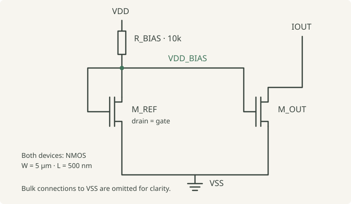

## Reading circuit structure

A SPICE netlist describes a circuit’s devices and connections in text rather than as a schematic. This tool uses those connections to recognize four circuit families: basic current mirrors, cascode current mirrors, differential pairs, and common-source amplifiers.

## How it works

The pipeline parses the netlist and builds a graph with separate nodes for components and nets. Edges retain each MOSFET terminal's identity (drain, gate, source, or bulk), even when multiple terminals connect to the same net. This lets the rules distinguish structures that a simpler connectivity graph would lose.

Structural rules score candidate topologies. Each result includes the competing scores, the connections supporting the decision, and a heuristic confidence category. Unsupported structures can return an unknown result.

## A current mirror, with the reasons visible

The [current-mirror test fixture](https://github.com/Muntaha15/analog-topology-classifier/blob/main/tests/test_scorer.py) includes these devices inside its `CURRENT_MIRROR` subcircuit:

```text
M_REF VDD_BIAS VDD_BIAS VSS VSS NMOS W=5u L=500n
M_OUT IOUT VDD_BIAS VSS VSS NMOS W=5u L=500n
R_BIAS VDD VDD_BIAS 10k
```

MOSFET terminals are listed as drain, gate, source, and bulk. `M_REF` has its drain and gate connected to `VDD_BIAS`, making it diode-connected. Both devices share that gate net and the source net `VSS`, and their width and length match. These are the structural and parameter checks used by the [current-mirror rule](https://github.com/Muntaha15/analog-topology-classifier/blob/main/classifier/topology_rules.py).



The fixture's classification test asserts:

| Result field | Expected value |
| --- | --- |
| Topology | Basic Current Mirror |
| Rule support | 1.0 |
| Confidence category | HIGH |

A support score of 1.0 means the example satisfies the rules, not a 100% probability of correctness. The repository also includes the [full example netlist](https://github.com/Muntaha15/analog-topology-classifier/blob/main/dataset/basic_cm_net.txt), which can be classified with:

```bash
python main.py --input dataset/basic_cm_net.txt --no-plots
```

## Implementation

The command-line pipeline connects parsing, graph construction, feature extraction, classification, and visualization. It produces CSV summaries, JSON evidence, static graphs, and interactive HTML views.

Tests cover parsing, graphs, classification, and rendering. Robustness checks include renamed components and nodes, reordered lines, parameter changes, and selected unsupported circuits.

## Limits

The rules cover four circuit families. Larger or unfamiliar designs can be ambiguous or incorrectly classified, and the included examples and synthetic checks are not a benchmark for arbitrary analog circuits. Confidence categories are heuristic.

The parser handles a subset of SPICE syntax and uses the first defined subcircuit. The tool checks connectivity and selected parameters; use circuit simulation to assess electrical behavior and performance.

## Explore the implementation

- [Source code, examples, and usage](https://github.com/Muntaha15/analog-topology-classifier)
- [Architecture notes](https://github.com/Muntaha15/analog-topology-classifier/blob/main/docs/architecture.md)
